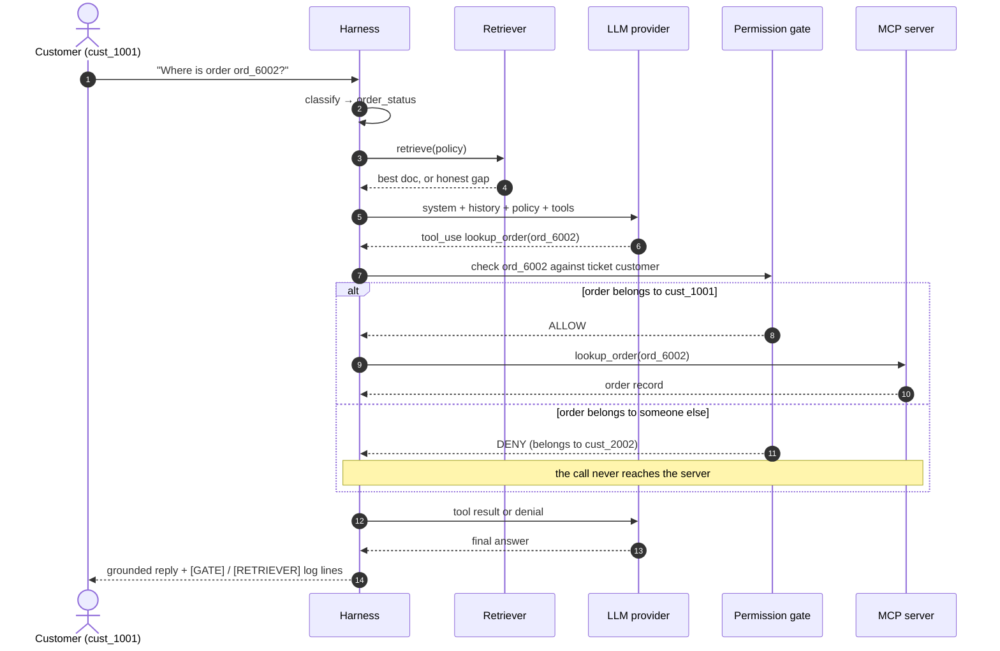
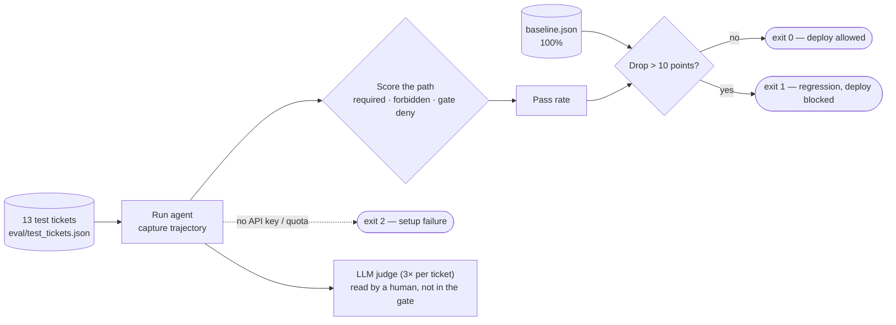
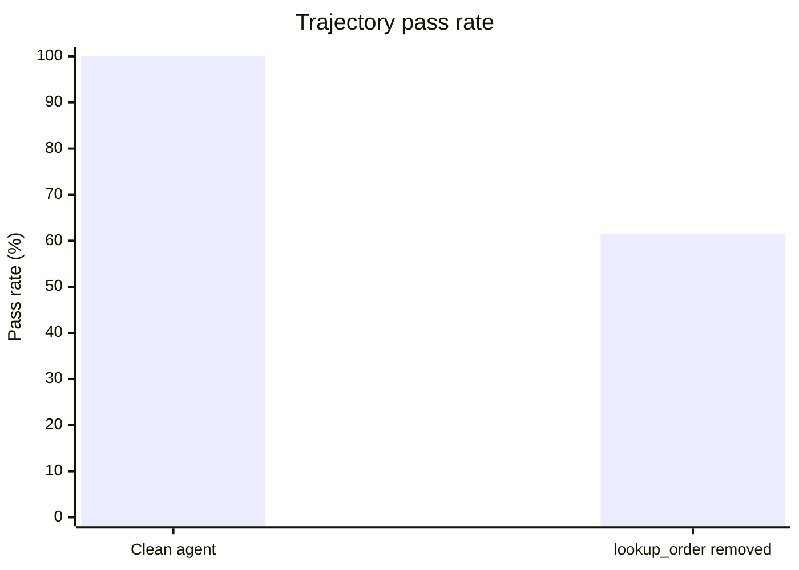
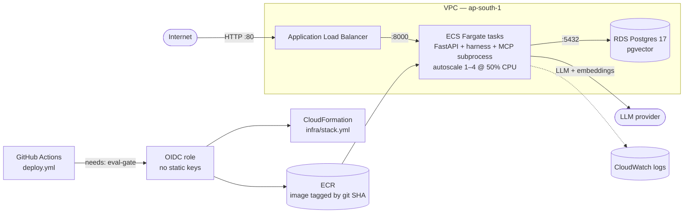

# eCom Order Support Agent — Harness, Tools & Grounding

[](https://github.com/iamr1ddl3/ecom-order-support-agent/actions/workflows/eval-gate.yml)


A multi-turn e-commerce order-support agent. It handles four ticket types — order
status, delivery issues, refund requests, and subscription/account questions —
by classifying each turn, retrieving the relevant policy, looking up real (mock)
order and account data through tools, and answering with memory across the
conversation. The defining property: **a harness I wrote — not the model —
decides whether each proposed tool call is allowed to run**, and it decides
*before* the call is dispatched. Order and account data are read through an MCP
server; policy answers are grounded in a retrieved policy doc (and the agent says
so honestly when no doc covers the question).

## At a glance

| | |
|---|---|
| **Ticket types** | 4 — order status · delivery issue · refund request · subscription/account |
| **LLM providers** | Anthropic · Groq · GLM (Z.ai) · OpenRouter (Anthropic, OpenAI and more with one key) |
| **Tools** | `lookup_order`, `check_account_status` over an MCP stdio server |
| **Grounding** | 6 policy docs · BM25 locally, pgvector on Postgres in production · honest gap when nothing matches |
| **Safety boundary** | Permission gate in the harness, checked **before** dispatch; MCP server re-checks ownership |
| **Evaluation** | 13-ticket trajectory eval (baseline 100%) · LLM-as-judge (mean 6.82/10) · CI gate at −10 points |
| **Interfaces** | CLI (`main.py`) · HTTP API (`app.py`: `/health`, `/ready`, `/chat`) |
| **Deployment** | Docker → ECS Fargate behind an ALB, RDS Postgres + pgvector, GitHub OIDC (no static keys) |

https://github.com/user-attachments/assets/104b7a98-7fb1-4dbc-8608-64599523628a

### Architecture


### One turn, step by step



### What each ticket type leans on

| Ticket type | Main capability |
|---|---|
| `order_status` | 🔧 Tool lookup (`lookup_order`) |
| `delivery_issue` | 🔧 Tool lookup **+** 📄 shipping-delay policy |
| `refund_request` | 📄 Policy retrieval (refund window, return eligibility, damaged items) |
| `subscription_account` | 🔧 `check_account_status` **+** 🧠 prior-ticket memory |

Retrieval and the customer's prior tickets are available on every turn; the
table shows what each type mostly depends on to answer well.

## Prerequisites

- **Python 3.10+** (developed on 3.14). For the default BM25 backend nothing else
  is needed — no database, no Docker, no embedding-model download. The
  pgvector backend does need Postgres and an OpenAI key; see
  [Retrieval on pgvector](#7-retrieval-on-pgvector).
- One LLM API key for any one of: **Anthropic** (default), **Groq** (free tier),
  **GLM via Z.ai**, or **OpenRouter** (one key for Anthropic, OpenAI and other
  vendors). Groq, GLM and OpenRouter share one OpenAI-compatible provider class.

## Setup

```bash
# 1. clone
git clone <your-repo-url>
cd ecom-order-support-agent

# 2. create and activate a virtual environment
python3 -m venv .venv
source .venv/bin/activate          # Windows: .venv\Scripts\activate

# 3. install dependencies
pip install -r requirements.txt

# 4. configure your key
cp .env.example .env
# then edit .env and set ONE of:
#   ANTHROPIC_API_KEY=...     (and set LLM_PROVIDER=anthropic)
#   GROQ_API_KEY=...          (and set LLM_PROVIDER=groq)
#   ZAI_API_KEY=...           (and set LLM_PROVIDER=glm)
#   OPENROUTER_API_KEY=...    (and set LLM_PROVIDER=openrouter; optional
#                              LLM_MODEL=anthropic/claude-sonnet-4.5 or openai/gpt-4.1)
```

## How to run it

**Start here — the scripted demo** runs all 5 ticket scenarios end to end (this is
what you'd show in a demo):

```bash
python main.py --demo
```

**Interactive chat** as a single customer (multi-turn, same ticket):

```bash
python main.py --customer cust_1001
```

Valid demo customers: `cust_1001`, `cust_2002`, `cust_3003`, `cust_4004`.
Add `--provider groq` / `--provider glm` / `--provider openrouter` (or set `LLM_PROVIDER`) to switch backend.

Every run prints, on screen:
- `[RETRIEVER] used chunk: <doc> (score=...)` — which policy doc grounded the answer,
  or `honest gap` when nothing covered the question.
- `[GATE] <tool>(<args>) -> ALLOW/DENY: <reason>` — the harness permission decision
  for every proposed tool call.

**Verify without an API key** (the harness gate, the MCP protections, the retriever):

```bash
python -m agent.test_gate         # permission gate: allow/deny truth table
python -m mcp_server.test_server  # MCP: schema rejection + scoped rejection, live
python -m rag.test_retriever      # retrieval hits expected docs; customs = honest gap
```

## Project structure

```
main.py                  CLI: --demo (5 scenarios) and --customer <id> (chat)
app.py                   HTTP API (FastAPI): /health, /ready, /chat
scenarios.py             the 5 demo ticket scenarios
agent/
  harness.py             THE harness loop + the permission gate (_permission_gate)
  providers.py           provider abstraction: get_provider('anthropic'|'groq'|'glm'|'openrouter')
  tools_schema.py        tool specs offered to the model, per-provider shape
  memory.py              short-term buffer + long-term prior-ticket lookup
  test_gate.py           permission-gate unit test (no LLM)
mcp_server/
  server.py              FastMCP stdio server: lookup_order, check_account_status
  mock_data.py           mock orders + accounts (shared customer IDs)
  test_server.py         MCP-layer test: schema + scoped rejection (no LLM)
rag/
  retriever.py           BM25 retriever behind a Retriever interface
  policy_docs/           6 policy docs; customs fees deliberately uncovered
  test_retriever.py      retrieval sanity check (no LLM)
data/
  prior_tickets.py       mock long-term memory, keyed by customer ID
```

Find the harness loop in `agent/harness.py` (`Harness._converse`), the permission
gate at `Harness._permission_gate` in the same file, the MCP server in
`mcp_server/server.py`, and the retriever in `rag/retriever.py`.

## Why I built the harness this way

**The permission boundary is in the harness, before dispatch — not inside the
tool.** The single most important line is in `agent/harness.py`,
`_run_tool_calls`: `decision = self._permission_gate(...)`, and the MCP dispatch on
the following lines runs *only* when `decision.allowed`. The model proposes a
`{tool, args}` call; the gate resolves the requested order/customer ID against the
ticket's bound customer and returns ALLOW or DENY; a denied call never reaches the
server. The MCP server (`mcp_server/server.py`) re-checks ownership too, so no
unscoped path exists anywhere — but that server check is defense-in-depth, not the
boundary. This is deliberate: a common mistake is letting the
proposed call execute and bolting the permission check on *inside* the tool as an
afterthought. Here the harness is the real boundary, and you can point at the exact
line where a proposed action is checked before it runs.

### Key design decisions

**1. How I scoped ticket types, and why.** Four types — `order_status`,
`delivery_issue`, `refund_request`, `subscription_account` — chosen because each
maps cleanly to a *different* combination of the two capabilities the agent has:
order/account tool lookups and policy retrieval. Order-status is tool-only;
refunds are retrieval-heavy; delivery issues need both (look up the order, then
apply the delay policy); account questions lean on long-term memory. Scoping by
*what the agent must do to answer* keeps classification (`Harness.classify`) a
cheap deterministic keyword map instead of another LLM call, and it makes the
capability each type needs obvious. Critically, a ticket is **bound to exactly one
customer at open time** (`Ticket.__init__`) — that binding is what makes
permission scoping enforceable: there is no ambiguous "current customer" for the
gate to guess.

**2. One specific permission-boundary decision.** The gate resolves an `order_id`
to its **owning customer** before allowing the call, rather than only checking that
the ID is well-formed. A well-formed ID for *someone else's* order (`ord_6002`,
owned by `cust_2002`, requested on a `cust_1001` ticket) is the exact leak this
prevents — see `[GATE] ... DENY: order 'ord_6002' belongs to cust_2002` in demo
scenario 5. The gate loads the same ownership source the tools use, so "who owns
this order" is answered once, consistently, at the boundary — not re-derived
differently in each tool.

## Not in scope (by design)

`issue_refund` — the one irreversible action — is intentionally not built. It
belongs in a later iteration, once human-in-the-loop approval and policy guardrails
exist to gate it. The permission gate already rejects it as an unoffered tool
(see `test_gate.py`).

---

# Tracing, Evaluation & the Regression Gate

Four layers on top of the same agent: real tracing, trajectory + LLM-judge
evaluation, a CI gate that blocks a regressed version, and a pgvector retrieval
backend.

## 1. Tracing setup

[LangFuse](https://cloud.langfuse.com) Cloud free tier. Create a project, then
**Settings → API Keys**, and put these in `.env`:

```bash
LANGFUSE_PUBLIC_KEY=pk-lf-...
LANGFUSE_SECRET_KEY=sk-lf-...
LANGFUSE_BASE_URL=https://cloud.langfuse.com   # LANGFUSE_HOST also works
```

Self-hosting instead? Only `LANGFUSE_BASE_URL` changes (e.g.
`http://localhost:3000`). **Keys are optional** — with none set, tracing degrades
to a no-op and the agent, tests and CI all run untraced.

```bash
python main.py --demo          # produces traces
python -m agent.audit_traces   # fetches them back and verifies nesting
```

`audit_traces` exists because a clean terminal run proves nothing about what
reached the dashboard. It asserts one root observation per trace, no orphans, and
correct observation *types*:

```
=== ticket-turn  (5 observations)
  [SPAN] ticket-turn
     └─ [GENERATION] groq-create
     └─ [GENERATION] groq-create
     └─ [RETRIEVER] retrieve-policy
     └─ [TOOL] lookup_order  gate=DENY
```

Verified on all 8 turns of a full `--demo` run. The gate decision rides on the
tool span, so a blocked cross-customer read is visible in the trace as an
*attempt that was denied* rather than a call that never happened.

## 2. Trajectory eval



```bash
python -m eval.trajectory_eval                  # score vs baseline
python -m eval.trajectory_eval --write-baseline # record a new known-good score
```

- **Test tickets:** `eval/test_tickets.json` — 13 tickets across all 4 ticket
  types.
- **Baseline:** `eval/baseline.json` — 100.0% (13/13).

It scores the **path**, not the prose, in three shapes:

| Assertion | Catches |
|---|---|
| `required_steps` (superset) | the required tool/retrieval never ran |
| `forbidden_steps` (disjoint) | the honest-gap ticket grounded itself in an unrelated doc |
| `expect_gate_deny` | the cross-customer read was **proposed AND blocked** |

`expect_gate_deny` checks *proposed and blocked* deliberately: a run where the
model never proposed the call proves nothing about the gate, and a naive "was
anything wrongly allowed?" check would pass it. See the before/after section below — that's exactly
what the regression does.

**The suite scored 100% on the first run, so `eval/test_check.py` exists** to
prove the scorer isn't vacuous. It feeds deliberately-broken trajectories in and
requires rejection. No LLM, runs free in CI.

## 3. Confident wrong path — `eval/CONFIDENT_WRONG_PATH.md`

**Two real cases**, both found by reading actual output. They fail in opposite
directions, which is the point:

| | T03 | T07 |
|---|---|---|
| Trajectory | contaminated | **correct** |
| Final answer | correct | **false** |
| Trajectory eval | PASS | PASS |
| LLM judge | 10.00 | **0.00** |

- **T03** — "did my standing desk arrive?" retrieves the *subscription
  cancellation policy* on the single word **"ever"** (from "first-ever
  subscription charge"). Answer is fine; unrelated policy silently entered the
  prompt. **Fixed by pgvector**, verified: `bm25 → [('subscription_cancellation',
  1.47)]`, `pgvector → []`.
- **T07** — the agent reports `ord_7004` *"delivered on 2026-07-18"*. The record
  says `status: delayed` and that date is the **estimate**. It then derives "9
  days late" and a severe-weather ruling from the misreading. The trajectory is
  correct, so no path check can catch it.

## 4. LLM-as-judge — `eval/JUDGE_RESULTS.md`

```bash
python -m eval.judge --provider groq
```

Fact-checking rubric ("does every specific claim appear in the reference?"),
scored against the policy doc / order record / prior tickets — never the agent's
own text. **39 real judge calls** (13 tickets × 3 runs). **Mean grounding: 6.82 /
10.**

Each input is scored 3× and averaged because judge scores are noisy: **4 of 13
tickets varied by ≥3 points across identical calls**, two by a full 7 points. The
spread prints beside every mean — a 6.00 from {4,10,4} is not a 6.00 from
{6,6,6}.

## 5. The CI gate

**File:** `.github/workflows/eval-gate.yml`. **Threshold: 10 points**, relative to
baseline.

Two jobs. `fast-checks` runs the no-LLM suites (no secrets, so fork PRs still get
signal, and a broken scorer can't hide behind a green eval); `eval-gate` then runs
the trajectory eval. **The pass/fail logic is in the Python, not the YAML** —
CI just runs the script and uses its exit code.

```bash
python -m eval.trajectory_eval; echo $?                                     # 0
AGENT_REGRESSION=drop_lookup_order python -m eval.trajectory_eval; echo $?  # 1
```

Exit codes are three-valued so the gate can't lie about why it's red:
**0** clean · **1** measured regression · **2** setup failure (no API key, etc).
That distinction exists because the first CI runs failed on a missing secret and
then on an exhausted provider quota, both reported as "regression" — and a gate
that goes red for the wrong reason is one people learn to ignore.

### Watched blocking a real regressed version

| Run | Branch | Result |
|---|---|---|
| [31296187273](https://github.com/iamr1ddl3/ecom-order-support-agent/actions/runs/31296187273) | feature branch | **success** — 13/13, gate PASS |
| [31296404885](https://github.com/iamr1ddl3/ecom-order-support-agent/actions/runs/31296404885) | `regression-demo` | **failure** — 8/13, −38.5 points, gate FAIL |

Branch `regression-demo` removes `lookup_order` from the offered tools and is
deliberately not for merge. CI reproduced the local before/after figure exactly
— same 61.5%, same five tickets — so the gate is measuring the agent, not the
runner.

## 6. Before/after — `eval/BEFORE_AFTER.md`



```bash
python -m eval.before_after --provider groq
```

**100% → 62%, and the tickets that flipped are T01, T02, T03, T06, T12.** A −38.5
point drop against a 10-point threshold.

The regression (`AGENT_REGRESSION=drop_lookup_order`) removes `lookup_order` from
the tools the model is offered. Every flipped ticket still produces a fluent,
honest, correctly-hedged answer — *"I don't have the current status of that
specific order"* — which is why a final-answer gate would have to call polite,
accurate refusals failures. The trajectory gate just sees the missing step.

**T12 is the flip that matters:** with the tool gone the model never proposes the
cross-customer read, so the permission gate is never exercised. The security
boundary stops being *tested* while nothing appears to break.

## 7. Retrieval on pgvector

```bash
docker run -d --name pgvector -p 5432:5432 -e POSTGRES_PASSWORD=postgres pgvector/pgvector:pg17
python -m rag.build_index                             # idempotent
RETRIEVAL_BACKEND=pgvector python -m rag.test_retriever
```

`rag/pgvector_retriever.py` embeds with OpenAI `text-embedding-3-small` (1536-dim;
via OpenRouter when only `OPENROUTER_API_KEY` is set)
and queries `policy_docs` with `<=>` (cosine distance), filtering in SQL. Same
`retrieve(query, k) -> [(doc_id, score, text)]` contract as BM25, so the harness
is untouched. `RETRIEVAL_BACKEND=bm25|pgvector` selects; both pass the same
`rag/test_retriever.py`.

**The threshold polarity inverts, and that's the trap.** BM25 is unbounded and
higher-is-better; cosine distance is 0–2 and lower-is-better. Carrying
`min_score=1.0` across would let every irrelevant doc through and silently destroy
the honest-gap path. Calibrated empirically rather than guessed:

```
worst correct hit  (damaged_items)                d = 0.4302
nearest wrong hit  (customs → shipping_delays)    d = 0.5313
=> DEFAULT_MAX_DISTANCE = 0.48  (midpoint, ~0.05 margin each side)
```

An intuitive guess of 0.62 "feels" strict for cosine distance and would have
broken the gap path.

## 8. Two design justifications

### 1. Why the regression threshold is 10 points

The suite has 13 tickets, so one ticket is ~7.7 points. **10 points tolerates
exactly one flaky ticket and fails on two.** That's the band I want: the agent is
a non-deterministic LLM, and a single turn legitimately phrasing itself without a
tool call is noise, while two is a pattern.

*Looser (20 points)* would wave through two genuinely broken ticket types — on
this suite that's an entire capability, like every order lookup failing, since
the tool-calling tickets cluster. *Tighter (5 points)* would make a single flaky
turn red the build; the gate would then get ignored or re-run until green, which
is worse than no gate because it looks like coverage. The observed regression
drops 38.5–53.8 points, so there's an order of magnitude of headroom above the
noise floor — the threshold isn't finely balanced, and it doesn't need to be.

It is **relative**, not absolute, because an absolute bar ("must score ≥70%")
lets a score rot downward forever without ever crossing the line. A relative
check catches the drift itself.

### 2. What the gate checks — and what that can't catch

**The gate checks the trajectory: which tool and retrieval steps actually ran.**
It does not read the final answer. That's deliberate: a final-answer
gate misses the regressions that matter, because a fluent answer built on a
skipped policy check reads exactly like a correct one.

**What it cannot catch is T07**: the agent called the right tool,
retrieved the right doc, then misread `status: delayed` as delivered and invented
a delivery date and a compensation ruling. The path is *correct*. No path check
can see that, and this is not hypothetical — the judge scored it 0.00 three times
while the trajectory eval passed it.

That is why the LLM judge exists alongside the gate. It is deliberately **not** in
the gate: a score that swings 7 points between identical runs cannot be a
build-breaking threshold without making the build a coin flip. So the division is
explicit — **the gate blocks capability regressions deterministically; the judge
catches grounding failures non-deterministically and is read by a human.**
Neither alone is sufficient, and T03 vs T07 is the proof.

## Evaluation, tracing and deployment file map

```
agent/
  tracing.py             LangFuse init; no-ops cleanly without keys
  audit_traces.py        fetch traces back, assert correct nesting
  harness.py             + tracing spans, + Ticket.steps trajectory capture
eval/
  test_tickets.json      13 tickets, 4 types, with required/forbidden steps
  trajectory_eval.py     the scorer AND the gate's exit code
  test_check.py          proves the scorer can fail (no LLM)
  judge.py               LLM-as-judge, 3x averaged, fact-checking rubric
  before_after.py        clean vs regressed, prints the flipped tickets
  baseline.json          100.0% known-good
  CONFIDENT_WRONG_PATH.md / JUDGE_RESULTS.md / BEFORE_AFTER.md
rag/
  pgvector_retriever.py  cosine-distance retrieval, same contract as BM25
  build_index.py         idempotent index build
.github/workflows/
  eval-gate.yml          fast-checks -> eval-gate (exit code decides)
```

## 9. AWS deployment — deployed and demonstrated

Full evidence in [`infra/DEPLOYMENT.md`](infra/DEPLOYMENT.md): real curl output,
the scale-out event, and the four bugs the live deploy exposed.

> **Status:** the stack was live on 2026-08-09 and has since been torn down to
> stop RDS billing. The ALB URL below no longer resolves. Run `infra/deploy.sh`
> to bring it back (~10 minutes).



### Architecture, named

| Thing | Value |
|---|---|
| ALB URL | `http://ecom-agent-alb-81067588.ap-south-1.elb.amazonaws.com` |
| ECS cluster / service | `ecom-agent-cluster` / `ecom-agent-service` |
| Task definition | `ecom-agent-task` — Fargate, 512 CPU / 1024 MiB |
| RDS instance | `ecom-agent-db` — `db.t4g.micro`, postgres 17.5, single-AZ, no replica |
| ECR image | `…dkr.ecr.ap-south-1.amazonaws.com/ecom-agent:<git-sha>` |
| Autoscaling | CPU target-tracking **50%**, min **1** / max **4** tasks |
| Region / Account | `ap-south-1` / `289702314533` |

**How pgvector wires in:** the task runs with `RETRIEVAL_BACKEND=pgvector` and a
`DATABASE_URL` pointing at the RDS endpoint, so `rag/pgvector_retriever.py`
queries `policy_docs` in RDS with `<=>` cosine distance. RDS is **not** publicly
accessible — its security group admits only the ECS task's security group, so the
index is seeded from inside the running task (`infra/seed_index.sh`), not from a
laptop. Security groups chain internet → ALB → task → database, each tier
admitting only the one above it.

### Deploy pipeline — OIDC, no static keys

[`.github/workflows/deploy.yml`](.github/workflows/deploy.yml) authenticates with
`sts:AssumeRoleWithWebIdentity` against role
`arn:aws:iam::289702314533:role/ecom-agent-github-deploy`. **There is no
`AWS_ACCESS_KEY_ID` or `AWS_SECRET_ACCESS_KEY` anywhere in this repository** —
verify with:

```bash
grep -rIn "AWS_SECRET_ACCESS_KEY\|AKIA" --include='*.yml' --include='*.sh' .
```

Every hit is a comment explaining their absence. Images are tagged by
`$GITHUB_SHA`, never `latest`. The deploy job declares `needs: eval-gate`, reusing
the gate via `workflow_call` so a regressed agent cannot reach AWS.

`infra/setup_oidc.sh` handles a common trap: GitHub's docs show
`repo:owner/repo:ref:…`, but the token carries stable **numeric** ids, so an exact
`StringEquals` silently never matches and fails as an unhelpful permissions error.
The trust policy uses a wildcarded `StringLike` on both forms.

### Teardown — tested, not just described

```bash
bash infra/teardown.sh
```

Handles the two ordering hazards that make teardown quietly fail: ECR won't
delete while images exist (so it's emptied first, and deliberately isn't a stack
resource), and the ECS service must drain before the target group detaches. It
finishes by **re-querying every resource** and exits non-zero if anything
survived — so "it said done" and "it is gone" are the same statement.

### Cost discipline

RDS bills continuously. Stand up → test → record → tear down, same day.
Roughly $0.05–0.08/hour for the whole stack.
