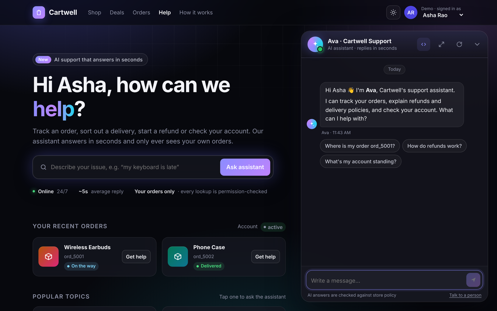
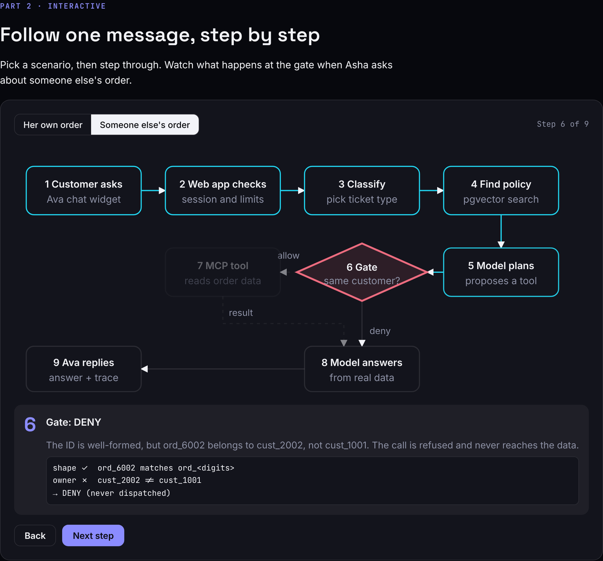
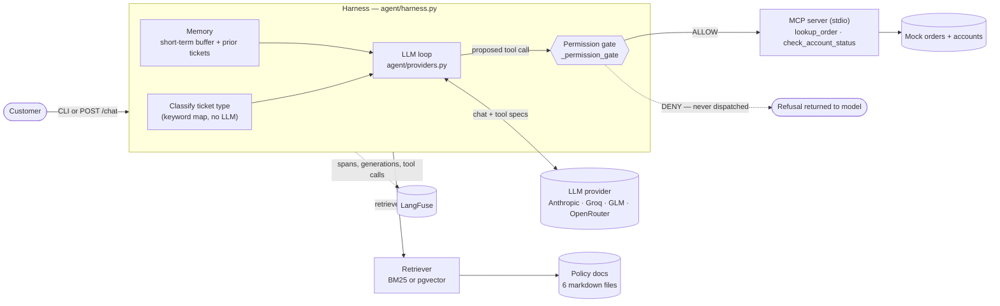

# eCom Order Support Agent

[](https://github.com/iamr1ddl3/ecom-order-support-agent/actions/workflows/eval-gate.yml)


[](https://ecom-agent.delightfulflower-dbb15f8e.centralindia.azurecontainerapps.io)

An AI customer-support agent for an online shop. It answers questions about orders, deliveries, refunds and accounts by looking up real (mock) order data through tools and grounding policy answers in the shop's own documents. Its defining property: **plain code in the harness, not the model, decides whether each tool call may run**, and it decides before the call is made. A customer can never see someone else's order, however the request is worded.

## Try it live

**[Open the live demo](https://ecom-agent.delightfulflower-dbb15f8e.centralindia.azurecontainerapps.io)** · **[See how it works](https://ecom-agent.delightfulflower-dbb15f8e.centralindia.azurecontainerapps.io/how-it-works)**

The demo is a small online shop, Cartwell, with an AI support assistant, Ava. Pick a demo customer, then ask about an order, a refund, or the account. Turn on the trace to watch each step: which policy was retrieved, which tool was called, and whether the permission gate allowed it. Try asking about another customer's order to see the gate refuse it.

**Watch the 2-minute explainer:**

<!-- Edit this README on github.com and drag docs video (ava-explained.mp4) here; GitHub turns it into an inline player link. -->

[](https://ecom-agent.delightfulflower-dbb15f8e.centralindia.azurecontainerapps.io)

The [how it works](https://ecom-agent.delightfulflower-dbb15f8e.centralindia.azurecontainerapps.io/how-it-works) page is an interactive walkthrough for anyone, technical or not. It steps through one message, lets you play the permission gate, and has a slider for the policy-match cutoff.

[](https://ecom-agent.delightfulflower-dbb15f8e.centralindia.azurecontainerapps.io/how-it-works)

**What is running in the demo right now**

| Part | Live setup |
|---|---|
| Model | Claude Haiku 4.5 through OpenRouter |
| Tools | MCP stdio server: `lookup_order`, `check_account_status` |
| Safety | Permission gate before every tool call; MCP server re-checks ownership |
| Policy search | pgvector on Neon Postgres, distance cutoff 0.51 |
| Quality | 13-ticket trajectory eval in CI (13/13), fails on a 10-point drop |
| Hosting | Azure Container Apps, scales to zero |
| Cost guards | 12 messages/min and 30/day per visitor, 300/day in total |

Orders and accounts are mock data.

## How it works



1. **Classify** the message into one of four ticket types with a keyword map (no LLM call).
2. **Retrieve** the closest policy doc. If nothing is close enough, the agent says so instead of guessing (the "honest gap").
3. **The model proposes** a tool call such as `lookup_order(ord_5001)`.
4. **The permission gate** checks the ID's shape and that it belongs to this conversation's customer. A denied call never reaches the tool.
5. **The MCP server** checks ownership again, then returns the record, and the model writes the reply.

**What each ticket type leans on**

| Ticket type | Main capability |
|---|---|
| `order_status` | 🔧 Tool lookup (`lookup_order`) |
| `delivery_issue` | 🔧 Tool lookup **+** 📄 shipping-delay policy |
| `refund_request` | 📄 Policy retrieval (refund window, return eligibility, damaged items) |
| `subscription_account` | 🔧 `check_account_status` **+** 🧠 prior-ticket memory |

Retrieval and the customer's prior tickets are available on every turn; the
table shows what each type mostly depends on to answer well.

More on the design choices: [docs/DESIGN.md](docs/DESIGN.md).

## Quick start

Needs Python 3.10+ and one LLM key (Anthropic, Groq, Z.ai GLM, or OpenRouter). The default BM25 retrieval needs no database.

```bash
git clone https://github.com/iamr1ddl3/ecom-order-support-agent.git
cd ecom-order-support-agent
python3 -m venv .venv && source .venv/bin/activate
pip install -r requirements.txt
cp .env.example .env        # set one key and LLM_PROVIDER (anthropic | groq | glm | openrouter)
```

```bash
python main.py --demo                  # 5 scripted scenarios, end to end
python main.py --customer cust_1001    # interactive chat as one customer
uvicorn app:app --reload               # web help center + chat at http://localhost:8000
```

Checks that need no API key:

```bash
python -m agent.test_gate          # permission gate: allow/deny truth table
python -m mcp_server.test_server   # MCP schema + ownership rejection
python -m rag.test_retriever       # retrieval hits expected docs; customs = honest gap
```

## Project structure

```
app.py              FastAPI: help center (/), walkthrough (/how-it-works), /chat, /ready
main.py             CLI demo and chat
agent/harness.py    the agent loop and the permission gate (_permission_gate)
agent/providers.py  Anthropic, Groq, GLM and OpenRouter behind one interface
mcp_server/         MCP stdio server: lookup_order, check_account_status (+ mock data)
rag/                BM25 and pgvector retrievers, 6 policy docs, index builder
eval/               trajectory eval, LLM-as-judge, baseline, reports
static/             the help center page and the how-it-works page
infra/              AWS stack, deploy and teardown scripts (earlier deployment)
```

## Quality and evaluation

- **Trajectory eval:** 13 realistic tickets, each checked for the steps the agent should take (which policy, which tool, what the gate decided). Baseline 13/13.
- **CI gate:** every push runs the eval in GitHub Actions and fails if the pass rate drops more than 10 points. A deliberately broken build fell to 61.5% and was blocked.
- **LLM-as-judge:** a second model scores answers for accuracy, grounding and tone (mean 6.82/10).
- **Tracing:** every turn is traced in Langfuse.

Details, results and the reasoning behind the threshold: [docs/EVALUATION.md](docs/EVALUATION.md).

## Deployment

The live demo runs on **Azure Container Apps** (scales to zero, about $5 a month) with **Neon Postgres + pgvector** for retrieval and **Claude Haiku 4.5 through OpenRouter**. Rebuild and roll out a new version:

```bash
docker build --platform linux/amd64 -t <registry>.azurecr.io/ecom-agent:<tag> .
docker push <registry>.azurecr.io/ecom-agent:<tag>
az containerapp update -g <resource-group> -n ecom-agent --image <registry>.azurecr.io/ecom-agent:<tag>
```

An earlier version ran on AWS (ECS Fargate, ALB, RDS, GitHub OIDC deploys) and has been torn down: [docs/DEPLOYMENT_AWS.md](docs/DEPLOYMENT_AWS.md).

## Not in scope

`issue_refund`, the one irreversible action, is intentionally not built. It needs human approval and policy guardrails first, and the gate already rejects it as an unoffered tool.
