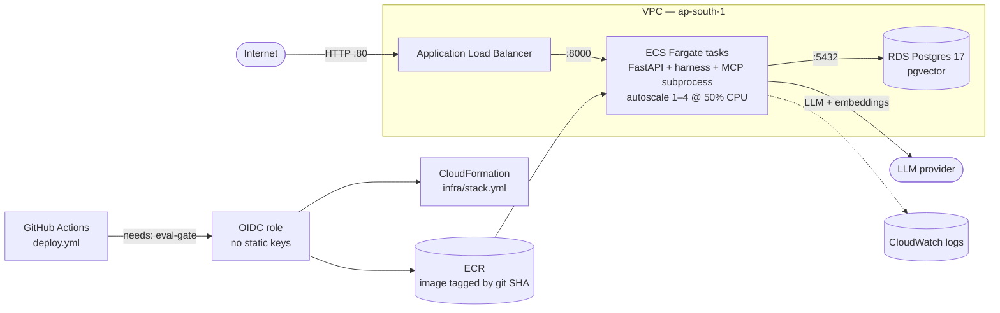

# AWS deployment (earlier, now torn down)

Full evidence in [`infra/DEPLOYMENT.md`](../infra/DEPLOYMENT.md): real curl output,
the scale-out event, and the four bugs the live deploy exposed.

> **Status:** the stack was live on 2026-08-09 and has since been torn down to
> stop RDS billing. The ALB URL below no longer resolves. Run `infra/deploy.sh`
> to bring it back (~10 minutes).



## Architecture, named

| Thing | Value |
|---|---|
| ALB URL | `http://ecom-agent-alb-81067588.ap-south-1.elb.amazonaws.com` |
| ECS cluster / service | `ecom-agent-cluster` / `ecom-agent-service` |
| Task definition | `ecom-agent-task` — Fargate, 512 CPU / 1024 MiB |
| RDS instance | `ecom-agent-db` — `db.t4g.micro`, postgres 17.5, single-AZ, no replica |
| ECR image | `…dkr.ecr.ap-south-1.amazonaws.com/ecom-agent:<git-sha>` |
| Autoscaling | CPU target-tracking **50%**, min **1** / max **4** tasks |
| Region / Account | `ap-south-1` / `289702314533` |

**How pgvector wires in:** the task runs with `RETRIEVAL_BACKEND=pgvector` and a
`DATABASE_URL` pointing at the RDS endpoint, so `rag/pgvector_retriever.py`
queries `policy_docs` in RDS with `<=>` cosine distance. RDS is **not** publicly
accessible — its security group admits only the ECS task's security group, so the
index is seeded from inside the running task (`infra/seed_index.sh`), not from a
laptop. Security groups chain internet → ALB → task → database, each tier
admitting only the one above it.

## Deploy pipeline — OIDC, no static keys

[`.github/workflows/deploy.yml`](../.github/workflows/deploy.yml) authenticates with
`sts:AssumeRoleWithWebIdentity` against role
`arn:aws:iam::289702314533:role/ecom-agent-github-deploy`. **There is no
`AWS_ACCESS_KEY_ID` or `AWS_SECRET_ACCESS_KEY` anywhere in this repository** —
verify with:

```bash
grep -rIn "AWS_SECRET_ACCESS_KEY\|AKIA" --include='*.yml' --include='*.sh' .
```

Every hit is a comment explaining their absence. Images are tagged by
`$GITHUB_SHA`, never `latest`. The deploy job declares `needs: eval-gate`, reusing
the gate via `workflow_call` so a regressed agent cannot reach AWS.

`infra/setup_oidc.sh` handles a common trap: GitHub's docs show
`repo:owner/repo:ref:…`, but the token carries stable **numeric** ids, so an exact
`StringEquals` silently never matches and fails as an unhelpful permissions error.
The trust policy uses a wildcarded `StringLike` on both forms.

## Teardown — tested, not just described

```bash
bash infra/teardown.sh
```

Handles the two ordering hazards that make teardown quietly fail: ECR won't
delete while images exist (so it's emptied first, and deliberately isn't a stack
resource), and the ECS service must drain before the target group detaches. It
finishes by **re-querying every resource** and exits non-zero if anything
survived — so "it said done" and "it is gone" are the same statement.

## Cost discipline

RDS bills continuously. Stand up → test → record → tear down, same day.
Roughly $0.05–0.08/hour for the whole stack.
