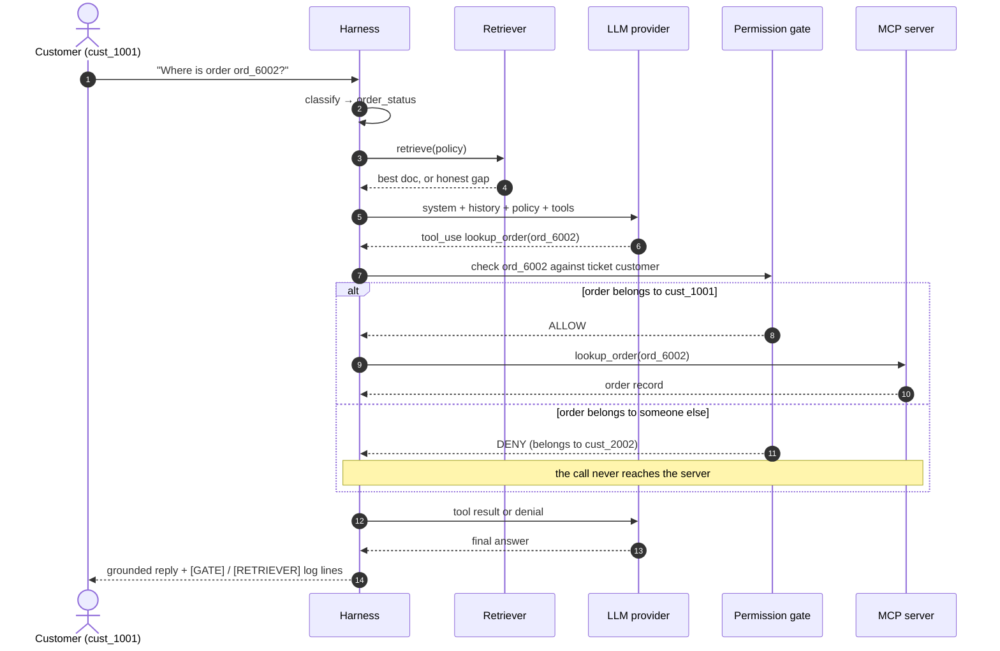

# Design notes

Why the agent is built the way it is. The short version is in the [README](../README.md).

## One turn, step by step

## Why I built the harness this way

**The permission boundary is in the harness, before dispatch — not inside the
tool.** The single most important line is in `agent/harness.py`,
`_run_tool_calls`: `decision = self._permission_gate(...)`, and the MCP dispatch on
the following lines runs *only* when `decision.allowed`. The model proposes a
`{tool, args}` call; the gate resolves the requested order/customer ID against the
ticket's bound customer and returns ALLOW or DENY; a denied call never reaches the
server. The MCP server (`mcp_server/server.py`) re-checks ownership too, so no
unscoped path exists anywhere — but that server check is defense-in-depth, not the
boundary. This is deliberate: a common mistake is letting the
proposed call execute and bolting the permission check on *inside* the tool as an
afterthought. Here the harness is the real boundary, and you can point at the exact
line where a proposed action is checked before it runs.

## Key design decisions

**1. How I scoped ticket types, and why.** Four types — `order_status`,
`delivery_issue`, `refund_request`, `subscription_account` — chosen because each
maps cleanly to a *different* combination of the two capabilities the agent has:
order/account tool lookups and policy retrieval. Order-status is tool-only;
refunds are retrieval-heavy; delivery issues need both (look up the order, then
apply the delay policy); account questions lean on long-term memory. Scoping by
*what the agent must do to answer* keeps classification (`Harness.classify`) a
cheap deterministic keyword map instead of another LLM call, and it makes the
capability each type needs obvious. Critically, a ticket is **bound to exactly one
customer at open time** (`Ticket.__init__`) — that binding is what makes
permission scoping enforceable: there is no ambiguous "current customer" for the
gate to guess.

**2. One specific permission-boundary decision.** The gate resolves an `order_id`
to its **owning customer** before allowing the call, rather than only checking that
the ID is well-formed. A well-formed ID for *someone else's* order (`ord_6002`,
owned by `cust_2002`, requested on a `cust_1001` ticket) is the exact leak this
prevents — see `[GATE] ... DENY: order 'ord_6002' belongs to cust_2002` in demo
scenario 5. The gate loads the same ownership source the tools use, so "who owns
this order" is answered once, consistently, at the boundary — not re-derived
differently in each tool.

## Not in scope (by design)

`issue_refund` — the one irreversible action — is intentionally not built. It
belongs in a later iteration, once human-in-the-loop approval and policy guardrails
exist to gate it. The permission gate already rejects it as an unoffered tool
(see `test_gate.py`).
